# TrialPilot — Technical Requirements

Version 0.3 · 14 October 2026 · Status: draft, pending approval of the items in §12

> Changes in 0.3: the decision model is now **fine-tuned before use, not used as
> shipped**. §6.1 records the measured behaviour of the untrained checkpoint — it is
> confidently wrong on ECOG and its "explicitly stated?" head has collapsed — and
> pins the field catalogue as actually implemented. A new §4.4 specifies the
> synthetic training corpus and the generator that produces it. §9 corrects the
> `truststore` note: it breaks **all** outbound HTTPS on Python 3.14, not just
> Hugging Face, and now has a fix. §11 adds R9 and R10 and rewrites R4; §12 closes
> open item 6 for stage 1.
>
> Changes in 0.2: the pipeline was re-specified against the flow the project owner
> described. The decision model now runs **before** the LLM at intake rather than
> only routing criteria; missing-details questioning is **optional**, driven by
> decision-model confidence; retrieval is a fixed 100–120 candidates with a
> similarity floor; eligibility filtering is a three-stage cascade; trial verdict,
> cost, tier and rank are all **computed**, with the LLM writing only prose; and
> the conformal coverage banner is **dropped**. §4.1 also replaces EmbeddingGemma 2
> with the jina model, which is the one that actually loads.

---

## 1. Purpose and authority

This document specifies the backend for TrialPilot and the frontend changes
required to connect it.

**Authority order when sources conflict:**

1. The existing frontend (`frontend/src`) — the source of truth for app flow and
   data shapes.
2. `app-design-idea.md` (v2, "TrialPilot").
3. `TrialMatch_BRD_v1.docx` (v1.0, "TrialMatch") — background only.

The BRD and the design doc describe materially different systems. The following
BRD requirements are **explicitly dropped**, by decision:

| BRD item | Status | Reason |
|---|---|---|
| FR-10, FR-11, NFR-03 — judge sub-agent + reflection loop | Dropped | The bounded clarification loop replaces reflection as the correction mechanism |
| FR-12 — met-rate/unknown-rate ranking formula | Replaced | Ranking is by verification cost (§6.7) |
| FR-20 — PDF export | Reduced to JSON only | |
| Streamlit / Gradio UI | Replaced | React frontend already built |
| TREC eval harness, KPI table (BRD §13) | Out of scope | No evaluation in this build |
| NFR-01 — p95 ≤ 60 s | **Void** | Verifying 100–120 candidates makes this unreachable; see §11 R2 |
| WHO ICTRP, CTIS, CTRI sources | Out of scope | ClinicalTrials.gov only |
| UMLS licence dependency | Avoided | RxNav + free sources instead |

Retained: FR-01..09, FR-13..15, FR-17, FR-18, FR-19, NFR-04, NFR-05, NFR-07, NFR-09.

---

## 2. Locked decisions

| Area | Decision |
|---|---|
| LLM | Azure OpenAI, deployment names configurable per role |
| Decision model | Laya multilingual, ONNX Runtime, local — **fine-tuned on synthetic data before use** (§4.4); the stock checkpoint is not fit for intake (§6.1) |
| Decision-model training data | Synthetic, ground-truth-first: labels are sampled in code, an LLM only writes the prose (§4.4) |
| Embeddings | jina-embeddings-v5-omni-nano, GGUF, 768-dim, in-process |
| Vector store | Qdrant **local on-disk mode** — no server, no cloud |
| Retrieval | Hybrid dense + sparse; fixed 100–120 candidates with a dense-cosine floor |
| Corpus | `INTERVENTIONAL` × {`RECRUITING`, `ACTIVE_NOT_RECRUITING`, `ENROLLING_BY_INVITATION`} |
| Orchestration | `deepagents` orchestrator + subagents |
| Intake parsing | Decision model first on bounded fields, LLM fills the remainder |
| Missing-details questioning | **Optional** — only when confidence is low or a fact is absent |
| Profile confirmation | **Always shown**, editable |
| Eligibility filtering | Three-stage cascade: predicates → decision model routing → LLM |
| Trial verdict, cost, tier, rank | **Computed by rule**; LLM writes only the explanation |
| Conformal coverage | **Dropped** — no banner, no guarantee claimed |
| State | SQLite; one `run_id`, resumable |
| Transport | SSE; trial cards stream as verified |
| Terminology | RxNav + free sources, no UMLS |
| Distance | Bundled US city/ZIP table + haversine |
| Clarification | LLM-generated options; max 3 rounds; gaps from top N trials |
| FHIR | Full R4 bundle parse |
| Tracing | LangSmith |
| Deployment | Local dev only |
| Scope | Open domain |
| Export | JSON only |
| Filters | Hard, at retrieval |
| Tests / CI | None |

---

## 3. Corpus

Measured from `backend/data/clinical_trials.parquet` (597,691 rows, 2.3 GB):

| Slice | Count |
|---|---|
| `RECRUITING` + `INTERVENTIONAL` | 47,343 |
| `ACTIVE_NOT_RECRUITING` (all types) | 21,858 |
| `ENROLLING_BY_INVITATION` (all types) | 5,236 |

Indexed set is the interventional intersection of the three statuses —
approximately **70–75k trials**. Eligibility text: median 1,244 chars, p90 5,057,
max 20,203.

---

## 4. Data layer

### 4.1 Embeddings

Model: `jina-embeddings-v5-omni-nano-retrieval-Q8_0.gguf`, 768 dimensions, run
in-process through `llama-cpp-python`.

**Not EmbeddingGemma 2.** That GGUF fails with `unknown model architecture:
'gemma-embedding2'`. The architecture landed in llama.cpp on 6 Oct 2026, but
0.3.36 is the newest wheel published on PyPI and on the abetlen index and bundles
an older llama.cpp; building from source fails in this environment. Revisit when
a wheel ships a newer llama.cpp, or move both models behind a `llama-server`
sidecar.

Implementation constraints, all measured:

- `n_ubatch` must equal `n_batch`. These are bidirectional encoders: past
  llama.cpp's 512-token default the process **aborts** on
  `GGML_ASSERT(cparams.n_ubatch >= n_tokens)`. langchain-community's
  `LlamaCppEmbeddings` cannot express this, so the service uses `llama_cpp.Llama`
  directly behind a LangChain `Embeddings` implementation.
- **One document per decode.** `n_seq_max` is 256 but the KV cache is `n_ctx`
  *shared across* sequences, so batching several full-length documents fails with
  `llama_decode returned -2`.
- `n_ctx = n_batch = 2048`. Higher sizes the logits buffer at
  `n_batch × 128,260 vocab × 4 bytes` — 3.91 GiB at 8192, which fails outright.
  2048 covers the p90 eligibility text.
- `n_threads = 2`, not 8: this CPU is 2 P-cores plus 8 E-cores and spilling onto
  the E-cores is slower. Measured 1.68 s/doc at 2 threads versus 2.07 s at 8.

### 4.2 Vector store

Qdrant local on-disk mode, path `backend/data/qdrant/`.

- Collection gains a **sparse vector** alongside the dense one for native hybrid
  search. The collection must be recreated.
- Payload fields used as hard filters: `overall_status`, `study_type`, `phases`,
  `intervention_types`, plus flattened `geo_points` for radius filtering.
- **Known limitation**: local mode warns that payload indexes have no effect.
  Filtering still works, unaccelerated. If filter latency becomes a problem at
  70k+ trials, a Qdrant server container is the escape hatch.
- Keep the uuid5 point-id scheme and the `nct_id` payload field.

### 4.3 SQLite

File: `backend/data/trialpilot.db`.

| Table | Purpose |
|---|---|
| `runs` | run_id, status, step, created/updated, filters, focus text, cancel flag |
| `run_events` | append-only SSE event log; replayed on resume |
| `profiles` | parsed and confirmed patient profile per run (JSON) |
| `criteria_cache` | parsed criteria keyed by `nct_id`, invalidated on `last_update_post_date` change |
| `routing_cache` | decision-model verdicts per criterion id — patient-independent, so computed once ever |
| `trial_results` | per-run per-trial verdict, criteria, cost, tier, score |
| `clarifications` | questions, options, answers, round number |
| `traces` | per-stage inputs/outputs, model, token counts, latency (BRD FR-15) |

`criteria_cache` and `routing_cache` are the main cost controls: both criterion
parsing and criterion routing are patient-independent, so each is done once per
trial rather than once per run.

---

### 4.4 Decision-model training data

The stock Laya checkpoint cannot do intake (§6.1), so stage 1 fine-tunes it. This
section specifies the corpus that training consumes.

**Generator**: `backend/tools/data/parser_train_data.py`, a single self-contained
script. It imports nothing from `src/`; the Laya question shape and the training-row
shape are duplicated into it deliberately and flagged there as mirrored contracts.

**The ordering principle: the label exists before the text does.** Rather than
writing narratives and labelling them, the generator samples a ground-truth patient
in code, then commissions prose to match. An LLM is called once per row and only
writes; it never decides an answer. This is what keeps the model's own ECOG mistakes
out of the training targets — the very failure measured in §6.1.

Four stages, one of which calls an LLM:

| Stage | What it does | LLM? |
|---|---|---|
| A | Sample a patient from a seed, and a **disclosure plan** tagging each field `explicit` / `implied` / `vague` / `omit` | no |
| B | Write the narrative obeying that plan | **yes** |
| C | Project ground truth onto Laya targets | no |
| D | Append JSONL rows plus a provenance manifest | no |

Facts marked `omit` are **never sent to the writer** — it cannot leak what it was
never told. Label projection follows from the plan: `explicit`/`implied` → the true
value; `vague` → a `gold` probability spread over neighbouring options; `omit` →
`unknown`; and "is this explicitly stated?" → true only for `explicit`. Because
stage A decides disclosure, that last gate is *exactly* known rather than inferred,
which is what makes the collapsed `noul` head learnable at all.

**Coverage** is two independent axes, crossed:

| Condition | % | | Presentation | % |
|---|---|---|---|---|
| Oncology | 70 | | Clinician shorthand | 30 |
| Non-oncology clinical | 20 | | Patient/caregiver prose | 30 |
| Off-topic / no patient | 10 | | Vague and hedged | 20 |
| | | | Partial | 15 |
| | | | Adversarial | 5 |

Off-topic rows label every bounded field `unknown`. They are how abstention is
taught rather than hoped for, and they are the reason a prompt like *"what's the
weather in Boston?"* must not yield a confident demographic.

**Label literals** are strict, and a wrong one does **not** raise — `laya/train.py`
counts it under `invalid_target` and silently drops the item. Choice answers are the
option key; `noul` answers are JSON booleans; score answers are the **zero-based
level index**, with fractional values interpolating across adjacent levels (this is
how "two or three prior lines" is expressed). The acceptance gate is therefore
`laya-train --dry-run`, which builds every item **without loading model weights** and
must report `skipped: {}`.

**Output**: one `intake_v1.train.jsonl` and one `intake_v1.eval.jsonl` under
`backend/data/synthetic/`, 1 row in 10 to eval, plus a manifest. Every row carries
its own `seed`, `generator`, `domain` and `presentation`; `train.py` reads only
`state`/`questions`/`expected`/`gold` and ignores the rest, so provenance is free at
training time and the corpus stays auditable without the manifest.

**Batching.** The corpus is built up over many runs, not one. `generate` always
appends and always skips seeds already on disk, so the same command is safe to
repeat; `--count` is rows added this batch, `--target` the overall goal. Every row
is flushed as written, so an interrupted batch keeps everything already paid for. A
`--max-failures` circuit breaker stops a batch whose endpoint has died rather than
burning the seed range, and `--restart` archives to timestamped `.bak` files rather
than deleting. Target is **10,000 narratives** (~106k trainable items).

**Generators** are a round-robin roster of `foundry:<claude-model>` and
`azure:<deployment>`, recorded per row so the corpus can be stratified or audited by
writer later. Mixing them is a diversity lever, not redundancy.

---

## 5. Architecture

```
React (TanStack Start)  ──HTTP + SSE, direct, CORS──▶  FastAPI
                                                          │
                                              deepagents orchestrator
                                                          │
   ┌───────────┬───────────┬───────────┬───────────┬──────┴────┬───────────┐
 decision   extractor   retriever   criteria-   verifier    ranker
  model                             parser
   │            │           │           │           │            │
 Laya ONNX   Azure       Qdrant      Azure      predicates    pure
 (local)     OpenAI      local +     OpenAI     + Laya +      Python
             + RxNav     jina        (cached)   Azure OpenAI
   └───────────┴───────────┴───────────┴───────────┴────────────┘
                                   │
                    SQLite (state, caches, traces) · LangSmith
```

Subagents are tools on the orchestrator, each with a Pydantic-typed output
contract. Every LLM call uses structured output (BRD NFR-04, 100%).

---

## 6. Pipeline

### 6.0 Flow

```mermaid
flowchart TD
    IN(["Patient details: narrative, FHIR bundle, or sample"])

    subgraph PARSE["Intake parsing - 6.1"]
        DM1["Decision model<br/>bounded fields only:<br/>sex, age band, smoking,<br/>pregnancy status, ECOG,<br/>prior lines"]
        LLM1["LLM<br/>open-ended remainder:<br/>medications, conditions,<br/>labs, biomarkers, dates"]
    end

    PROFILE["Parsed patient profile<br/>source span per fact<br/>confidence per bounded field"]
    GAPS{"Low confidence or<br/>missing protocol-critical fact?"}

    subgraph ASK["Optional questioning - 6.2"]
        LLM2["LLM drafts bounded questions"]
        USER1["Clinician answers"]
        DM2["Decision model re-answers<br/>with the new facts in context"]
    end

    COMPLETE["Complete patient profile"]
    CONFIRM["Confirm profile - 6.3<br/><b>always shown</b><br/>clinician reviews and edits"]
    RETRIEVE["Retrieve 100-120 candidates - 6.4<br/>hybrid dense plus sparse, over the profile<br/>dense-cosine floor<br/>hard filters: status, phase, intervention, geo"]
    PARSEC["Parse and route criteria - 6.5<br/>eligibility text to structured criteria<br/>cached per nct_id<br/>overflow past the cap marked unverifiable"]

    subgraph VERIFY["Verification cascade - 6.6"]
        direction TB
        PRED["1 - Predicates in Python<br/>age, sex, lab thresholds, date windows"]
        DM3["2 - Decision model<br/>routing plus bounded yes/no"]
        LLM3["3 - LLM entailment<br/>only criteria needing judgement"]
        PRED --> DM3 --> LLM3
    end

    CLAR{"Unknown criteria<br/>in the top N trials?"}
    USER2["Clinician answers<br/>max 3 rounds, then unverifiable"]
    SCORE["Compute verdict, cost, tier, rank - 6.7<br/><b>all by rule, reproducible</b><br/>LLM writes only the explanation prose"]
    OUT(["Shortlisted trials, streamed as each is verified"])

    IN --> DM1 --> LLM1 --> PROFILE --> GAPS
    GAPS -- yes --> LLM2 --> USER1 --> DM2 --> COMPLETE
    GAPS -- no --> COMPLETE
    COMPLETE --> CONFIRM --> RETRIEVE --> PARSEC --> VERIFY --> CLAR
    CLAR -- yes --> USER2 --> VERIFY
    CLAR -- no --> SCORE --> OUT

    classDef llm fill:#f5a05a,stroke:#b4692c,color:#1a1a19
    classDef dm fill:#6c63d6,stroke:#44409a,color:#ffffff
    classDef code fill:#3b82c4,stroke:#215a94,color:#ffffff
    classDef rule fill:#2f6e4e,stroke:#1d4a33,color:#ffffff
    class LLM1,LLM2,LLM3 llm
    class DM1,DM2,DM3 dm
    class PRED code
    class SCORE rule
```



Three properties this flow depends on, each easy to lose when redrawing it:

- **Parsing needs both models.** The decision model cannot produce a patient
  profile on its own (§6.1); it answers bounded fields and the LLM fills the rest.
  A diagram showing the decision model alone producing structured output is
  describing something unbuildable.
- **Ranking happens last, not at retrieval.** Nothing can be ranked by
  eligibility until criteria have been evaluated. Retrieval orders by similarity;
  the displayed ranking is computed in §6.7.
- **The last step before output is rule-based.** That is what makes the same
  patient and corpus produce the same shortlist every run.

### 6.1 Intake and parsing

Input: narrative text, FHIR R4 bundle, or a sample-patient id.

**The decision model runs first, on bounded fields only.** Laya is a
non-generative encoder: it scores options declared in advance and cannot emit free
text, arrays or nested objects. Its schema mode rejects them explicitly — *"a free
string cannot be a fixed option set"*, *"arrays are not supported"*, *"nested
objects are not supported"*, with enums capped at 32 options and ordinal scores at
10 levels. It therefore **cannot produce a `PatientProfile`**, and must not be
asked to.

What it does answer, from a field catalogue:

| Scope | Fields | Laya form | Options |
|---|---|---|---|
| Universal | sex | enum → choice | `female` `male` `unknown` |
| Universal | age band | enum → choice | `under_18` `18_39` `40_64` `65_74` `75_plus` `unknown` |
| Universal | smoking status | enum → choice | `never` `former` `current` `unknown` |
| Universal | pregnancy/menopausal status | enum → choice | `pregnant` `premenopausal` `postmenopausal` `not_applicable` `unknown` |
| Universal | performance status | enum → choice | `ecog_0`…`ecog_4` `unknown` |
| Universal | "is each of the above explicitly stated?" | boolean → noul | — |
| Oncology | prior lines of systemic therapy | integer → score | `0` `1` `2` `3` `4+` |

Every choice field carries an explicit `unknown` so that "not in the text" is an
answer the model can give rather than a guess it is forced into. `not_applicable` is
**not** a synonym for `unknown`: a male patient's menopausal status is answerable the
moment his sex is readable, and conflating the two leaves that option untrained.

The catalogue is keyed by condition: a universal set always asked, plus
condition-specific entries. The six fields currently hardcoded in the frontend
become the oncology entry — four of them are Laya-shaped, while LVEF date (a date)
and comorbidities (free text) are not and fall to the LLM or to the clinician.

**Three of these answers have nowhere to live in the frontend `PatientProfile`.**
`smoking_status` and `pregnancy_menopausal_status` have no field at all, and
`sex: "F" | "M"` cannot represent `unknown` even though that is a real answer. Age is
worse than a mapping gap: Laya emits a *band*, never an integer, so
`demographics.age: number` must come from the LLM with the band as a cross-check.
See §8 and open item 7.

**The stock checkpoint is not usable for this, measured not assumed.** Probed
2026-10-14 against the real `laya-multilingual-onnx` graph with the catalogue above:

| Field | Answered | Truth | Confidence | |
|---|---|---|---|---|
| sex | `female` | female | 0.908 | passes |
| pregnancy/menopausal | `postmenopausal` | postmenopausal | 0.864 | passes |
| **performance status** | **`ecog_0`** | **ECOG 1** | **0.836** | **wrong, and clears the gate** |
| age band | `under_18` | 40–64 | 0.297 | abstains |
| prior lines | `1` | 3 | 0.500 | abstains |

The dangerous cell is ECOG, not age. `under_18` for a 63-year-old is absurd enough
that the abstention gate catches it; a plausible-but-wrong `ecog_0` at 0.836 sails
through and silently mis-screens the patient against every ECOG 0–1 trial.

**The `noul` head is collapsed** on the stock checkpoint and carries no signal:
sex *not* stated → 0.0006, age *is* stated → 0.0415, ECOG *not* stated → 0.0133,
menopausal *is* stated → 0.544. Stated and unstated are indistinguishable. Since
§6.2 triggers clarification off exactly this signal, that trigger cannot work until
the head is trained.

**Therefore the decision model is fine-tuned before use** on the synthetic corpus in
§4.4. The table above is the baseline that fine-tuning must beat, and re-measuring
it over the eval split is the acceptance test.

> Contingency if fine-tuning does not close the gap: run Laya advisory with the LLM
> authoritative on every field, Laya's disagreement forcing that field onto the
> confirmation screen. **Not the current design** — recorded so the option is not
> rediscovered from scratch.

**The LLM then fills the remainder** into the same `PatientProfile`: medications,
conditions, labs, biomarkers, stage and dates, every fact carrying the source text
span it came from. On the FHIR path this is a deterministic parse of `Patient`,
`Condition`, `MedicationStatement` and `Observation` instead, with facts marked
high confidence and carrying a resource-id pointer; the decision model still
answers any bounded field the bundle does not contain.

**Normalisation**: medications to RxNorm via RxNav. Conditions and labs to
SNOMED / LOINC via free releases where a confident match exists, left as plain
text otherwise. A code is **never** emitted by the LLM alone — an unmatched fact
stays uncoded rather than carrying a guessed code.

**Confidence.** Each bounded field carries the decision model's
`answer_confidence`. Note this is raw softmax: the multilingual checkpoint ships
`temperature: [1.0, 1.0, 1.0]` and an empty `temperature_by_options`, so the
numbers order fields by shakiness but are not trustworthy as absolute
probabilities. See §11 R4.

Laya returns **two** confidence figures and `src/services/decision_lm.py` reads
`answer_confidence`, the argmax probability. The other one, `confidence`,
discriminates far better on the probe above — age band scores 0.0845 against sex's
0.6717, where `answer_confidence` gives 0.2967 against 0.9083. Fine-tuning fits
abstention thresholds as a side effect (`--target-error`), so which field to gate on
is settled after training, against the eval split, rather than guessed now.

### 6.2 Missing-details questioning — optional

Triggered only when the decision model reports low confidence on a bounded field,
or a protocol-critical fact is absent. **If nothing is missing, this step is
skipped entirely** and the run proceeds to confirmation.

> The "is this explicitly stated?" signal this step depends on carries no
> information on the stock checkpoint (§6.1) and is one of the things §4.4's corpus
> is built to train. Until the fine-tune is measured, treat this trigger as unbuilt.
> The fallback, if the head stays unreliable, is to fire on *Laya abstained **and**
> the LLM found no source span* — two signals that demonstrably work.

The backend returns field specifications; the frontend renders them:

```ts
type MissingField = {
  id: string; label: string; hint: string;
  kind: "choice" | "text" | "textarea";
  options?: string[]; required: boolean;
};
```

Answers are merged as first-class facts with clinician provenance, and the bounded
fields are re-answered with the clinician's input in context.

### 6.3 Profile confirmation — always shown

The clinician reviews and edits the assembled profile before any search runs. This
is the only point at which a bad parse can be corrected, and it sits before the
expensive stages deliberately. Satisfies BRD FR-17. Low-confidence facts are
flagged in the UI.

### 6.4 Retrieval

Hybrid dense + sparse search over the indexed corpus, fused server-side.

- Query built from the **confirmed** profile: condition terms, biomarkers, stage,
  prior therapy.
- **Target 100–120 candidates**, with a floor applied to the **dense cosine
  similarity** — not the fused score, which is a ranking artefact and has no
  meaning as a percentage. A weak match returns fewer candidates rather than
  padding the list with noise.
- The floor starts permissive and is **calibrated from the observed distribution
  over real queries**. The 0.75 figure in the original sketch is a placeholder:
  cosine similarity is not comparable across queries, so a fixed cutoff can return
  nothing or thousands depending on how the patient's text happens to embed.
- The dense cosine is retained per trial and shown as the match score.
- **Hard filters** as payload filters before scoring: recruitment status, phase,
  intervention type, geo radius. Trials excluded here never cost a token.
- **Focus field** (free text): query expansion and a re-ranking preference, not a
  hard filter — a hard filter on free text silently empties the result set.

### 6.5 Criterion parsing and routing

Eligibility text → structured `Criterion[]` via LLM structured output, cached in
`criteria_cache` by `nct_id`.

- **Per-trial cap**: `MAX_CRITERIA_PER_TRIAL` (proposed 40, §12). Overflow is
  marked `unverifiable` with reason `criteria_cap_exceeded`, never silently
  dropped.
- Eligibility text over 20,000 characters is truncated at a section boundary and
  the trial flagged.
- **Routing** assigns each criterion a path — `deterministic` / `predicate` /
  `narrative` — and is where the decision model sits. A wrong route costs
  efficiency, never correctness. Cached in `routing_cache`; no verdict or
  eligibility judgment comes from it.

### 6.6 Verification — the three-stage cascade

Each criterion is resolved by the cheapest stage that can answer it:

1. **Predicates, in Python** — age, sex, numeric lab thresholds, date windows,
   prior-line counts. Free, exact, reproducible. A small predicate library, not a
   general solver.
2. **Decision model** — routes what the predicates could not resolve, and answers
   bounded yes/no questions about the profile.
3. **LLM entailment** — only for criteria genuinely needing judgment, returning a
   verdict plus a mandatory evidence pointer (source, value, date) or an explicit
   missing-data marker (BRD FR-09).

**Polarity — confirmed.** For an exclusion criterion, `met` means *the patient
passes it* (does not have the excluded thing). `unmet` means the exclusion applies
and blocks enrollment.

**The silence rule.** When the record says nothing about a criterion:

- If the fact would have appeared in a structured list we hold — medications,
  labs, problem list — silence means absent. The criterion resolves, and the
  evidence pointer records that it was **inferred from absence**, not observed.
- If the fact is narrative-only, the criterion is `unknown` and becomes a
  clarification candidate.

Inferred-from-absence criteria are visually distinct in the evidence popover. This
is a deliberate, bounded closed-world assumption; it is the single most
safety-relevant rule in the system and is traced for every criterion it touches.

### 6.7 Scoring, tiering and ranking — all computed

Nothing numeric comes from a model. The same patient and the same trials always
produce the same ranking.

**Trial verdict** — derived by rule from the criterion verdicts:

| Verdict | Rule |
|---|---|
| `ineligible` | any criterion blocks enrollment |
| `eligible` | all criteria resolved and passing |
| `eligible_pending_unknown` | otherwise |

**Verification cost** — sum of per-criterion minutes over `unknown` criteria only;
resolved criteria cost 0. Proposed table (§12, approved for tuning later):

| semantic_class | deterministic | predicate | narrative |
|---|---|---|---|
| demographic | 0 | 1 | 2 |
| performance | 2 | 3 | 5 |
| lab | 2 | 3 | 5 |
| temporal | 3 | 4 | 6 |
| condition | 3 | 5 | 8 |
| treatment | 4 | 6 | 10 |
| biomarker | 5 | 8 | 10 |
| other | 5 | 8 | 12 |

**Tier**:

| Tier | Rule |
|---|---|
| `ineligible` | trial verdict is `ineligible` |
| `high` | verification cost = 0 |
| `quick_check` | 0 < cost ≤ 10 min, no unverifiable criteria |
| `manual_review` | cost > 10 min, or any unverifiable criterion |

**Evidence completeness** (the card's 0–1 bar, currently named
`calibrated_confidence`) — `0.7 × resolved_ratio + 0.3 × normalised_retrieval_score`,
clamped to [0,1], where `resolved_ratio = (met + unmet) / total_criteria`. It
measures how much of the criteria set was resolved, **not** a probability of
eligibility, and the frontend label changes accordingly.

**No conformal coverage.** The banner is removed. No calibrated guarantee is
claimed anywhere, because no labelled calibration set exists. The scoring
interface is shaped so a real split-conformal calibrator could be added later.

**The LLM's only job here** is writing the per-trial `explanation` prose from the
computed verdict and criterion evidence.

**Ranking** — ascending verification cost within tier; tier order
high → quick_check → manual_review → ineligible; distance as tiebreak.

### 6.8 Clarification loop

- Gaps are the `unknown` criteria from the **top N** trials by rank — not all
  100–120, which would produce hundreds of questions.
- Options are LLM-generated per criterion: 2–4 structured choices plus "can't
  determine".
- **Max 3 rounds.** Each later round is LLM-selected from both newly-exposed gaps
  and lower-priority gaps held back earlier.
- After round 3, anything unresolved is marked `unverifiable` and its trial tagged.
- Answers become first-class profile facts with clinician provenance; only
  affected criteria are re-verified, re-scored and re-ranked.

---

## 7. API

FastAPI, called directly from the browser with CORS. No auth, no rate limiting.

| Method | Path | Purpose |
|---|---|---|
| `POST` | `/runs` | Create a run from narrative / FHIR bundle / sample id + filters + focus → `{run_id}` |
| `GET` | `/runs/{id}/events` | **SSE** stream; replays prior events on reconnect |
| `GET` | `/runs/{id}` | Full run state, for resume after refresh |
| `POST` | `/runs/{id}/missing-details` | Submit answers; triggers re-parse |
| `PATCH` | `/runs/{id}/profile` | Confirm-screen edits |
| `POST` | `/runs/{id}/screen` | Start the screening pipeline |
| `POST` | `/runs/{id}/clarifications` | Submit answers; triggers re-screen |
| `POST` | `/runs/{id}/cancel` | Cooperative cancel; subagents check the flag between units of work |
| `GET` | `/runs/{id}/export.json` | Ranked output with evidence trail and disclaimer |
| `GET` | `/samples` | Sample patients, served from the backend |

Model-inference harness routes (`/embed/predict`, `/decision/predict`,
`/llm/predict`) already exist and stay. **Ingestion has no HTTP surface** — it is
a batch job, run with `tools/ingest.py`.

### SSE event contract

```ts
{ type: "stage.start",    stage, index, total, label, substeps }
{ type: "stage.substep",  stage, substep, index }
{ type: "stage.complete", stage, duration_ms }
{ type: "log",            id, agent, action, ts, status }
{ type: "missing_fields", fields: MissingField[] }   // empty = skip the screen
{ type: "profile",        profile: PatientProfile }
{ type: "trial.verified", trial: TrialPilot }        // progressive cards
{ type: "clarifications", questions: ClarificationQuestion[] }
{ type: "run.complete",   counts }
{ type: "error",          trace_id, stage, message, retryable }
```

Payloads conform to `frontend/src/lib/trialmatch/types.ts` and are validated
against the Pydantic models before emission (BRD FR-13). There is no `coverage`
event.

---

## 8. Frontend changes

| File | Change |
|---|---|
| `routes/index.tsx` | Step machine driven by backend run status; `run_id` in the URL for resume; **skip the missing-details step when `missing_fields` is empty** |
| *(new)* `lib/api/` | HTTP client + SSE hook |
| `MissingDetailsForm.tsx` | **Rewrite as data-driven** from `MissingField[]`; delete the hardcoded `MISSING_FIELDS` |
| `LiveProcessing.tsx` | Real SSE stages and substeps; delete the mocked timings. The remaining-time estimate must be real or removed |
| `ProcessingStream.tsx` | Same, for parsing and re-parsing |
| `ResultsDashboard.tsx` | **Remove the coverage banner entirely**, along with `COVERAGE` and the `CoverageStatement` type |
| `ResultsDashboard.tsx` | Progressive card insertion; remove hardcoded `87`, `412`, "Boston, MA" and the static filter summary; remove the PDF export item; wire JSON export |
| `ResultsDashboard.tsx` / `TrialDetailPanel.tsx` | Relabel "Calibrated confidence" → "Evidence completeness"; add the retrieval match score |
| `ClarificationLoop.tsx` | Real questions; wire "Ask another round" to the backend |
| `IntakeScreen.tsx` | Wire the FHIR file input; load samples from `/samples`; send filters and focus |
| `ProfileConfirmation.tsx` | `PATCH` edits to the backend |
| `TrialDetailPanel.tsx` | Show the inferred-from-absence marker in evidence popovers |
| *(new)* error states | Surface `trace_id`, retry affordance, cancel control |

Layout, tokens, `ScrollArea` usage, the disclaimer and accessibility rules are
unchanged.

---

## 9. Configuration

Model names and Azure settings live in `backend/.env`; see `src/config/settings.py`
for the full key list. Notes that bite:

- `uv add` needs `--native-tls` behind the corporate proxy, and the
  llama-cpp-python index must keep `explicit = true`.
- **`truststore` breaks every outbound HTTPS call on this interpreter**, not just
  Hugging Face. Under Python 3.14 it recurses until the C stack overflows inside
  `ssl.SSLContext.wrap_socket`, surfacing as
  `RecursionError: Stack overflow (used ~1952 kB)` — an error that reads like a bug
  in the calling code. It is **not opted into**: `pip_system_certs.pth` injects it
  into every process started from this venv, and the injected copy is pip's
  vendored one, so the standalone `truststore` package cannot undo it. The fix is
  `pip._vendor.truststore.extract_from_ssl()` at process start; verification then
  falls back to certifi, which verifies both the Azure and Foundry hosts.
  `tools/data/parser_train_data.py` does this in `_disable_broken_truststore()`.
  Model checkpoints are still staged as **local directories**, not Hub ids.
- `load_dotenv` does not override real environment variables.
  `AZURE_OPENAI_API_KEY` is already exported on this machine.
- **Azure deployments differ on the token parameter.** Reasoning-era deployments
  (`gpt-5.x`) reject `max_tokens` and require `max_completion_tokens`; older ones
  reject the new name. Nothing in the deployment name says which, so it is resolved
  by trying one and falling back. The budget must also cover hidden reasoning
  tokens — a budget spent entirely on those returns an empty string, not an error.
- **Do not set `azure_deployment` on the `AzureOpenAI` client** if the deployment is
  also chosen per call: it goes into the URL path and silently overrides the `model`
  argument, so requests reach the wrong deployment while being recorded as the right
  one.
- The `ANTHROPIC_FOUNDRY_*` variables already exported on this machine are approved
  for project use. That endpoint is Azure-hosted, serves `claude-opus-5` and
  `claude-sonnet-5` (not the 5.5 generation), and has **no Message Batches API** —
  so bulk generation gets no batch discount and throughput comes from concurrency.

---

## 10. Build order

Stage by stage, each finished before the next.

| Stage | Deliverable |
|---|---|
| 1 | Ingest the ~70–75k slice into Qdrant with sparse vectors and payload fields |
| 2 | Hybrid retrieval, hard filters, geo radius, dense-cosine floor calibration |
| 3 | SQLite schema, run lifecycle, SSE scaffolding, cancel |
| 4 | Intake: decision-model field catalogue, LLM extraction, FHIR parser, RxNav |
| 5 | Optional missing-details questioning; profile confirmation |
| 6 | Criterion parsing, routing, both caches |
| 7 | Verification cascade: predicates, decision model, LLM entailment, silence rule |
| 8 | Computed verdict, cost, tier, ranking; LLM explanation |
| 9 | Clarification loop and re-verification |
| 10 | Frontend integration (§8), JSON export, error states |

Stages 1–2 are partly done: ingestion runs via `tools/ingest.py`, and the
embedding, decision and LLM services exist behind harness routes.

Stage 4 now has a prerequisite that is **in progress**: the decision model must be
fine-tuned before the field catalogue is worth wiring in, so §4.4's corpus is being
generated in batches. Stage 4 splits into 4a generate the corpus, 4b fine-tune and
re-measure §6.1's baseline, 4c wire the catalogue into intake. Training itself is
**not** scheduled on this machine — see R10.

---

## 11. Risks

| ID | Risk | Mitigation |
|---|---|---|
| R1 | Full ingestion of ~70–75k trials takes ~22 h at 1.7 s/doc and **cannot resume** — a failure restarts from row 0 | Add a checkpoint, mirroring `tools/fetch_trials_data.py`, before the first full run |
| R2 | **Latency.** 100–120 trials × 12–45 criteria is thousands of operations per run; runs take minutes | Both caches, per-trial cap, predicates-first cascade, progressive card streaming. BRD NFR-01 is formally void |
| R3 | No tests and no eval harness — no regression safety and no measurement of verdict accuracy | Accepted by decision. LangSmith traces are the only observability |
| R4 | Decision-model confidence is **uncalibrated** raw softmax, yet gates whether the clinician is asked anything. Measured consequence: a wrong `ecog_0` at 0.836 clears any sane gate (§6.1) | Fine-tuning fits abstention thresholds as a side effect (`--target-error`). Until then, treat every bounded field as unverified and rely on the §6.3 confirmation screen, which is mandatory and sits before any expensive stage |
| R5 | Qdrant local mode has no payload indexes; filtering is unaccelerated at 70k+ trials | Measure at Stage 2; escape hatch is a Qdrant server container |
| R6 | The closed-world silence rule can declare eligibility on absence of evidence | Scoped to structured lists only; marked inferred in the evidence trail; traced per criterion |
| R7 | The dense-cosine floor is uncalibrated; a wrong value returns nothing or everything | Start permissive, measure the distribution over real queries, then set it |
| R8 | The verification cost table is unvalidated against real clinician effort | Tunable in one file; revisit with a clinical contact |
| R9 | The §4.4 corpus is **entirely synthetic and LLM-written**. Real users may phrase things in ways no generator produced, and the model would inherit that blind spot invisibly — it would score well on an eval drawn from the same distribution | Five presentation registers and an adversarial slice widen it deliberately; the three real `SAMPLE_NARRATIVES` anchor the clinician register. Treat eval-split accuracy as an upper bound, not an estimate of field performance. The first real narratives collected are worth more than another 1,000 synthetic rows |
| R10 | **Training cannot run on this machine.** CPU-only torch, 2 performance cores, ~2.7 GB free; a full fine-tune of the ~322M-parameter checkpoint needs ~5.2 GB of optimiser state alone | `--freeze-encoder` fits locally (~11 h for 2k narratives) but trains only the heads, which may fix label-mapping failures like `age_band` while leaving ECOG inference — an encoder-level task — untouched. Unresolved; decide before stage 4b |

---

## 12. Open items

1. **`MAX_CRITERIA_PER_TRIAL = 40`** — median trial parses to ~12 criteria, p90 ~45.
2. **`CLARIFICATION_TOP_N_TRIALS`** — no value set.
3. **Tier boundary at 10 minutes** — proposal.
4. **Dense-cosine floor value** — to be set from measurement (R7).
5. **Azure specifics** — endpoint, API version, and the five deployment names.
6. ~~**Field catalogue contents** beyond the universal set and the oncology entry.~~
   **Closed for stage 1**: the catalogue is pinned in §6.1 and implemented in the
   generator. Conditions beyond oncology still have no condition-specific entries —
   reopen when a second specialty is targeted.
7. **`PatientProfile` has no home for three catalogue answers** (§6.1):
   `smoking_status` and `pregnancy_menopausal_status` have no field, and
   `sex: "F" | "M"` cannot express `unknown`. Decide whether to widen the frontend
   type or keep these in the matching layer only.
8. **Where fine-tuning runs** (R10) — locally with a frozen encoder, or off-box with
   the encoder unfrozen.
9. **Corpus size at which to stop.** 10,000 is the current target; the honest
   stopping rule is eval-split accuracy plateauing, which cannot be known until 4b.

Deferred by decision: conformal calibration, TREC evaluation, PDF export, other
registries, reflection/judge loop, auth, tests, CI, Docker.

---

## 13. Non-goals

No PHI. No clinical advice. No enrolment automation. No multilingual UI. No mobile.
No hosted deployment. The disclaimer — *"TrialPilot is a research and educational
screening aid. It is not clinical advice and must not be used as the sole basis for
treatment decisions."* — stays visible on every screen and in every export
(BRD FR-19).
